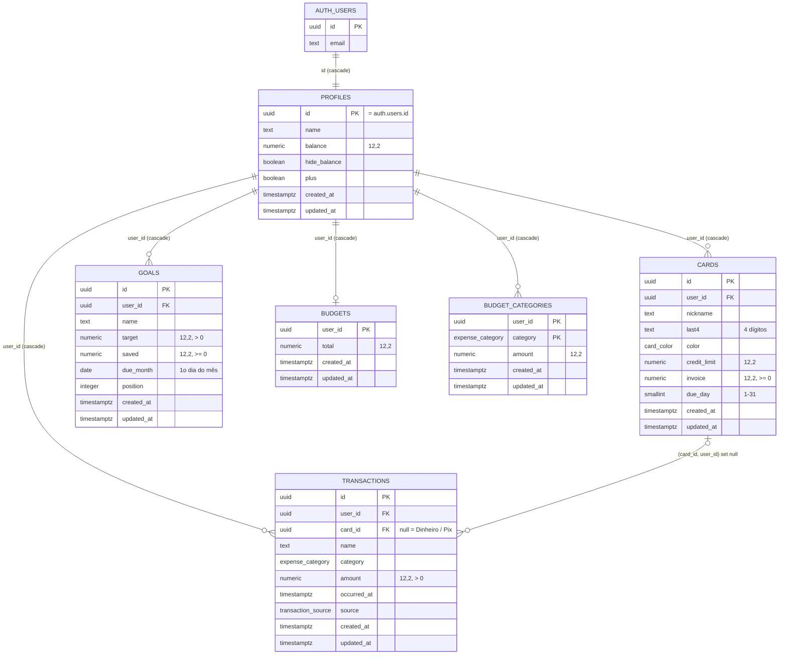

# Banco de dados · Eskgo (Supabase)

Banco real do Eskgo no Supabase. **O app está ligado a ele** quando `VITE_SUPABASE_URL` e `VITE_SUPABASE_ANON_KEY` estão no `.env`: login pelo Supabase Auth, leitura em `src/services/remote.ts` (`loadSnapshot`) e gravação por entidade (`persist`). Sem essas variáveis, o app roda offline com `localStorage`. Este documento descreve o banco e como o app o usa.

| | |
|---|---|
| Projeto | `ESKGO-PROJECT` · região `sa-east-1` (São Paulo) · Postgres 17 |
| Fonte da verdade | `supabase/migrations/*.sql` (aplicadas, idênticas ao banco) |
| Seed | `supabase/seed.sql` (conta demo + dados mock de `src/lib/seed.ts`) |
| Prisma | `prisma/schema.prisma`, **só documentação** (não instalado, não migra) |
| Checklist | [`checklist.md`](./checklist.md) |

## Sumário

1. [Visão geral](#1-visão-geral)
2. [Diagrama ER](#2-diagrama-er)
3. [Tabelas e colunas](#3-tabelas-e-colunas)
4. [Segurança: RLS, policies e grants](#4-segurança-rls-policies-e-grants)
5. [Funções, triggers e RPCs](#5-funções-triggers-e-rpcs)
6. [Storage](#6-storage)
7. [Mapeamento app ↔ banco](#7-mapeamento-app--banco)
8. [Conta demo e seed](#8-conta-demo-e-seed)
9. [Como trocar ou apagar os dados mock](#9-como-trocar-ou-apagar-os-dados-mock)
10. [Variáveis de ambiente](#10-variáveis-de-ambiente)
11. [Migrations](#11-migrations)
12. [Como foi validado](#12-como-foi-validado)

---

## 1. Visão geral

- Cada pessoa tem um **perfil** (`profiles`, 1:1 com `auth.users`) com saldo, "ocultar saldo" e o plano Plus.
- Ela cadastra **cartões** (`cards`), lança **gastos** (`transactions`), define o **teto do mês** (`budgets` + `budget_categories`) e guarda dinheiro em **metas** (`goals`).
- Toda tabela do `public` tem **RLS**: cada pessoa só vê e altera as próprias linhas. O papel `anon` (visitante sem login) não acessa nada.
- Operações que mexem em duas tabelas ao mesmo tempo (gasto → saldo + fatura; meta → saldo) são **RPCs atômicas** (`SECURITY INVOKER`, respeitam a RLS).
- Faturas enviadas no estágio 2 vão para o bucket privado **`faturas`**, numa pasta por pessoa.
- Dinheiro é sempre `numeric(12,2)` (até R$ 9.999.999.999,99, duas casas, sem erro de ponto flutuante). Datas são `timestamptz`. Ids são `uuid` (`gen_random_uuid()`).

## 2. Diagrama ER



## 3. Tabelas e colunas

Todas as tabelas têm `created_at timestamptz default now()` e `updated_at timestamptz default now()`, atualizado sozinho por trigger em todo `UPDATE`.

### Tipos (enums)

| Enum | Valores |
|---|---|
| `expense_category` | `Moradia`, `Alimentação`, `Transporte`, `Lazer`, `Outros` (iguais a `CATEGORIES` em `src/lib/types.ts`) |
| `card_color` | `gradient`, `champagne`, `offwhite` |
| `transaction_source` | `manual`, `fatura` |

### `profiles`: perfil (1:1 com `auth.users`)

| Coluna | Tipo | Regra |
|---|---|---|
| `id` | `uuid` PK | = `auth.users.id`; `on delete cascade` |
| `name` | `text` | até 80 caracteres; default `''` |
| `balance` | `numeric(12,2)` | saldo; pode ficar negativo |
| `hide_balance` | `boolean` | default `false` |
| `plus` | `boolean` | Eskgo Plus (estágio 2); default `false` |

Criada pelo trigger `on_auth_user_created`. O e-mail não é duplicado aqui: vem da sessão (`auth.users.email`).

### `cards`: cartões

| Coluna | Tipo | Regra |
|---|---|---|
| `id` | `uuid` PK | `gen_random_uuid()` |
| `user_id` | `uuid` FK → `profiles.id` | `on delete cascade` |
| `nickname` | `text` | 1 a 40 caracteres |
| `last4` | `text` | exatamente 4 dígitos (`^[0-9]{4}$`) |
| `color` | `card_color` | default `champagne` |
| `credit_limit` | `numeric(12,2)` | `>= 0` (`limit` é palavra reservada no SQL) |
| `invoice` | `numeric(12,2)` | fatura atual; `>= 0` |
| `due_day` | `smallint` | dia do vencimento, 1 a 31 |

Índices: `(user_id, created_at desc)` e `unique (id, user_id)`, alvo da FK composta de `transactions`.

### `transactions`: gastos

| Coluna | Tipo | Regra |
|---|---|---|
| `id` | `uuid` PK | `gen_random_uuid()` |
| `user_id` | `uuid` FK → `profiles.id` | `on delete cascade` |
| `card_id` | `uuid` | `null` = Dinheiro / Pix |
| `name` | `text` | 1 a 120 caracteres |
| `category` | `expense_category` | |
| `amount` | `numeric(12,2)` | `> 0` (o app mostra com "−") |
| `occurred_at` | `timestamptz` | quando o gasto aconteceu; default `now()` |
| `source` | `transaction_source` | `manual` ou `fatura`; default `manual` |

- **FK composta** `(card_id, user_id) → cards (id, user_id)`: um gasto só pode apontar para um cartão **da mesma pessoa**. Sem isso, quem descobrisse o uuid do cartão de outra pessoa poderia ligar um gasto a ele, porque checagem de FK não passa pela RLS.
- `on delete set null (card_id)`: excluir o cartão zera **só** o `card_id`, e o gasto continua no histórico como "Dinheiro / Pix" (decisão de produto).
- Índices: `(user_id, occurred_at desc)` para a busca "gastos do mês" e `(card_id, user_id)` para a FK.

### `goals`: metas

| Coluna | Tipo | Regra |
|---|---|---|
| `id` | `uuid` PK | `gen_random_uuid()` |
| `user_id` | `uuid` FK → `profiles.id` | `on delete cascade` |
| `name` | `text` | 1 a 60 caracteres |
| `target` | `numeric(12,2)` | `> 0` |
| `saved` | `numeric(12,2)` | `>= 0`; muda pela RPC `save_to_goal` |
| `due_month` | `date` | opcional; sempre o 1º dia do mês ("Dez 2027" = `2027-12-01`) |
| `position` | `integer` | ordem na tela (crescente) |

Índice: `(user_id, position)`.

### `budgets`: teto total do mês

| Coluna | Tipo | Regra |
|---|---|---|
| `user_id` | `uuid` PK, FK → `profiles.id` | `on delete cascade` |
| `total` | `numeric(12,2)` | `>= 0`; default 0 |

Uma linha por pessoa, criada pelo trigger de cadastro. O teto vale para todos os meses (igual ao app hoje).

### `budget_categories`: teto por categoria

| Coluna | Tipo | Regra |
|---|---|---|
| `user_id` | `uuid` FK → `profiles.id` | PK composta, `on delete cascade` |
| `category` | `expense_category` | PK composta |
| `amount` | `numeric(12,2)` | `>= 0` |

Categoria sem linha = teto 0. O app grava com *update* e, se não havia linha, *insert* (o `upsert` do PostgREST esbarra no grant por coluna).

## 4. Segurança: RLS, policies e grants

### RLS

Habilitada nas 6 tabelas. Toda policy é `to authenticated` e compara com `(select auth.uid())`. O `select` em volta faz o Postgres calcular o uid uma vez por consulta, e não uma vez por linha.

| Tabela | select | insert | update | delete |
|---|---|---|---|---|
| `profiles` | `profiles_select_own` (`id = uid`) | (nenhuma; trigger cria) | `profiles_update_own` | (nenhuma; sai em cascata com `auth.users`) |
| `cards` | `cards_select_own` | `cards_insert_own` | `cards_update_own` | `cards_delete_own` |
| `transactions` | `transactions_select_own` | `transactions_insert_own` | `transactions_update_own` | `transactions_delete_own` |
| `goals` | `goals_select_own` | `goals_insert_own` | `goals_update_own` | `goals_delete_own` |
| `budgets` | `budgets_select_own` | `budgets_insert_own` | `budgets_update_own` | `budgets_delete_own` |
| `budget_categories` | `budget_categories_select_own` | `budget_categories_insert_own` | `budget_categories_update_own` | `budget_categories_delete_own` |

Nas tabelas com `user_id`, a condição é `(select auth.uid()) = user_id`. O `update` usa `using` e `with check`, para ninguém mover uma linha para outra pessoa.

### Grants (privilégio mínimo)

| Papel | O que pode |
|---|---|
| `anon` | **nada** nas tabelas e nas RPCs |
| `authenticated` | `profiles`: `select` + `update (name, balance, hide_balance, plus)` |
| | `cards`, `transactions`, `goals`, `budgets`, `budget_categories`: `select`, `insert`, `delete` + `update` só nas colunas de dados (nunca `id`, `user_id`, `created_at`, `updated_at`) |
| | `execute` nas 9 RPCs |
| `service_role` | `select/insert/update/delete` em todas as tabelas (só servidor; ignora RLS) |

Além disso, `alter default privileges` faz com que tabelas e funções criadas no futuro no `public` não deem acesso ao `anon` por padrão.

> ⚠️ **ATENÇÃO (antes de cobrar pelo Plus):** hoje `plus` é um interruptor livre no app (Avatar → Eskgo Plus), então a pessoa pode alterar a própria coluna `plus`. Quando o Plus virar pago, rode `revoke update (plus) on public.profiles from authenticated;` e passe a ligar o Plus só pelo servidor (webhook de pagamento com `service_role`). As rotas `/api` da IA devem conferir `plus` no banco, não no front.

> 💡 **Sugestão:** o cliente ainda consegue gravar gastos direto na tabela. Isso é permitido pela RLS, mas não mexe no saldo nem na fatura. Para manter os números certos, o app deve usar **sempre as RPCs** nas operações que mexem em saldo ou fatura (tabela da seção 7).

## 5. Funções, triggers e RPCs

Todas as funções têm `set search_path = ''` e usam nomes qualificados (`public.…`, `auth.uid()`).

### Triggers

| Trigger | Tabela | Função | O que faz |
|---|---|---|---|
| `on_auth_user_created` | `auth.users` (after insert) | `handle_new_user()` · **SECURITY DEFINER** | cria `profiles` (nome = `raw_user_meta_data.name` ou a parte do e-mail antes do `@`) e `budgets` |
| `*_set_updated_at` | as 6 tabelas (before update) | `set_updated_at()` · invoker | `updated_at = now()` |

`handle_new_user` precisa ser `SECURITY DEFINER` porque roda quando o Auth cria o usuário, antes de existir sessão. O `EXECUTE` dela e o de `set_updated_at` foram revogados de `public`, `anon` e `authenticated` (só o trigger as chama).

### RPCs (`supabase.rpc(...)`)

Todas são `SECURITY INVOKER` (rodam com a RLS de quem chama), exigem sessão (sem `auth.uid()` dão erro `42501 Sessão obrigatória`) e só o `authenticated` pode executar. Como cada RPC é uma transação, ou tudo acontece, ou nada acontece.

| RPC | Parâmetros | Efeito | Retorno |
|---|---|---|---|
| `add_transaction` | `p_name, p_category, p_amount, p_occurred_at?, p_card_id?, p_source? = 'manual', p_id?` | insere o gasto; `balance −= amount`; se tiver cartão, `invoice += amount` | o gasto |
| `update_transaction` | `p_id, p_name, p_category, p_amount, p_occurred_at, p_card_id?` | desfaz o gasto antigo e aplica o novo (saldo e fatura, inclusive trocando de cartão) | o gasto |
| `delete_transaction` | `p_id` | apaga; `balance += amount`; `invoice −= amount` (mínimo 0) | o gasto apagado |
| `import_invoice` | `p_card_id, p_items jsonb` | insere os itens como `source = 'fatura'`; `balance −= soma`; `invoice = soma` (igual ao reducer `tx/import`); até 500 itens | os gastos criados |
| `add_goal` | `p_id, p_name, p_target, p_saved? = 0, p_due_month?, p_position? = 0` | cria a meta; `balance −= saved` (regra única: tudo o que está numa meta saiu do saldo) | a meta |
| `save_to_goal` | `p_goal_id, p_amount` | `saved += amount`; `balance −= amount`. Valor negativo = "Desfazer". Não deixa `saved < 0` | a meta |
| `delete_goal` | `p_goal_id` | apaga a meta; `balance += saved` | a meta apagada (para o "Desfazer") |
| `restore_goal` | `p_id, p_name, p_target, p_saved, p_due_month, p_position` | recria a meta com o mesmo id e posição; `balance −= saved`. Se já existir, não faz nada e devolve `null` | a meta ou `null` |
| `monthly_spending` | `p_months = 2, p_tz = 'America/Sao_Paulo'` | soma dos gastos por mês (até 24 meses) | `(month date, total numeric)` |

Formato de `p_items` em `import_invoice`:

```json
[{ "name": "Netflix", "category": "Lazer", "amount": 55.9, "occurred_at": "2026-11-03T15:00:00Z" }]
```

Erros que o app deve tratar: `P0002` (não encontrado, inclusive quando a linha é de outra pessoa), `22023` (valor inválido), `23514` (regra de check, por exemplo guardado negativo), `23503` (cartão que não é seu), `42501` (sem sessão ou sem permissão).

## 6. Storage

| Bucket | Público | Limite | MIME permitidos | Uso |
|---|---|---|---|---|
| `faturas` | **não** | 15 MB (igual à tela Fatura) | `application/pdf`, `image/jpeg`, `image/png`, `image/webp`, `image/heic`, `image/heif` | PDF ou foto da fatura (estágio 2) |

**Caminho obrigatório:** `{auth.uid()}/{yyyy-mm}/{uuid}.{ext}`, por exemplo `d828…/2026-11/3f2c….pdf`.

Policies em `storage.objects` (`faturas_select_own`, `faturas_insert_own`, `faturas_update_own`, `faturas_delete_own`): só vale `bucket_id = 'faturas'` **e** primeira pasta do caminho = `auth.uid()`. O `anon` não tem policy nenhuma.

```ts
// exemplo (quando o app for ligado)
const path = `${session.user.id}/${new Date().toISOString().slice(0, 7)}/${crypto.randomUUID()}.pdf`
await supabase.storage.from('faturas').upload(path, file, { contentType: file.type })
```

- O tamanho e o MIME são aplicados pela **Storage API** no upload, não por SQL.
- O Supabase bloqueia `DELETE` direto em `storage.objects` via SQL. Para apagar um arquivo, use a Storage API (`supabase.storage.from('faturas').remove([...])`) ou o painel.
- Não foi criado bucket de avatar: o app mostra iniciais, sem foto.

## 7. Mapeamento app ↔ banco

### Tipos (`src/lib/types.ts`) → colunas

| App | Banco | Conversão |
|---|---|---|
| `AppState.user.name` | `profiles.name` | direto |
| `AppState.user.email` | `auth.users.email` | vem de `session.user.email` |
| `AppState.signedIn` | sessão do Supabase Auth | `!!session` |
| `AppState.version` | (não existe) | só do `localStorage` |
| `AppState.balance` | `profiles.balance` | `Number()` |
| `AppState.hideBalance` | `profiles.hide_balance` | direto |
| `AppState.plus` | `profiles.plus` | direto |
| `AppState.previousMonthTotal` | **não existe**: calculado | `monthly_spending(2)` → total do mês anterior |
| `Transaction.id` | `transactions.id` (`uuid`) | ver "ids" abaixo |
| `Transaction.name / category` | `name / category` | direto (mesmas categorias, com acento) |
| `Transaction.cardId` | `card_id` | `null` = Dinheiro / Pix |
| `Transaction.date` | `occurred_at` | ISO 8601 nos dois lados |
| `Transaction.amount` | `amount` | `Number()` |
| `Transaction.source` | `source` | direto |
| `Card.nickname / last4 / color / invoice` | mesmas colunas | `Number()` em `invoice` |
| `Card.limit` | `credit_limit` | renomeado (`limit` é palavra reservada) |
| `Card.dueInDays` | `due_day` | **calculado** (abaixo) |
| `Goal.name / target / saved` | mesmas colunas | `Number()` nos valores |
| `Goal.date` ("Dez 2027") | `due_month` (`2027-12-01`) | **convertido** (abaixo) |
| ordem das metas | `goals.position` | `order('position')` |
| ordem dos cartões | `cards.created_at desc` | o mais novo primeiro (igual ao `card/add`) |
| `Budget.total` | `budgets.total` | `Number()` |
| `Budget.byCategory` | linhas de `budget_categories` | montar o `Record`, com 0 para categoria sem linha |

### As 4 divergências do `CLAUDE.md`, resolvidas

**1. `dueInDays` × `due_day`.** O banco guarda o **dia do mês** em que a fatura vence. Assim o valor não "envelhece" (um `dueInDays` gravado ficaria errado no dia seguinte). O app calcula os dias na hora:

```ts
/** dias até o próximo vencimento, a partir do dia do mês (1–31) */
export function dueInDays(dueDay: number, today = new Date()): number {
  const y = today.getFullYear(), m = today.getMonth(), d = today.getDate()
  const dayIn = (yy: number, mm: number) => Math.min(dueDay, new Date(yy, mm + 1, 0).getDate()) // 31 → 30/28
  let due = new Date(y, m, dayIn(y, m))
  if (d > due.getDate()) due = new Date(y, m + 1, dayIn(y, m + 1))
  return Math.round((due.getTime() - new Date(y, m, d).getTime()) / 86_400_000)
}
/** caminho inverso, enquanto o formulário pedir "vence em X dias" */
export const dueDayFromDays = (days: number, today = new Date()) =>
  new Date(today.getFullYear(), today.getMonth(), today.getDate() + days).getDate()
```

O formulário de cartão ainda pede "vence em X dias". Quando ligar o banco, vale trocar o campo por "dia do vencimento" (1–31), que é como a fatura funciona de verdade.

**2. Meta "Dez 2027" × `due_month`.** O banco guarda uma `date` com o **1º dia do mês** (check garante isso). O formulário de meta já usa `<input type="month">` (`"2027-12"`):
- gravar: `due_month = value ? \`${value}-01\` : null`
- ler: `date = due_month ? monthToLabel(due_month.slice(0, 7)) : undefined` (funções já existentes em `OtherSheets.tsx`)

**3. `previousMonthTotal` não existe no banco.** Ele é **calculado** a partir dos gastos: `supabase.rpc('monthly_spending', { p_months: 2 })` devolve o total do mês atual e do anterior, no fuso `America/Sao_Paulo`. Para a demo continuar mostrando a mesma comparação, o seed grava 10 gastos no mês anterior somando **R$ 2.659,00**, o mesmo valor que estava fixo no `seed.ts`.

**4. ids curtos × `uuid`.** Todo id no banco é `uuid`. Duas opções, ambas aceitas:
- deixar o banco gerar (não mandar `id`); ou
- gerar no app com `crypto.randomUUID()` (no lugar de `uid()` de `format.ts`), útil para atualização otimista. `add_transaction` aceita `p_id`.

Os ids do seed (`'principal'`, `'japao'`, `'t1'`…) só existem no modo offline. No banco viram uuids, e os gastos apontam para os cartões pelo uuid.

### Actions do reducer → operação no Supabase

| Action (`store.tsx`) | Operação |
|---|---|
| `tx/add` | `rpc('add_transaction')` |
| `tx/update` | `rpc('update_transaction')` |
| `tx/delete` | `rpc('delete_transaction')` |
| `tx/import` | `rpc('import_invoice')` |
| `card/add` | `from('cards').insert(...)` |
| `card/update` | `from('cards').update(...).eq('id', id)` |
| `card/delete` | `from('cards').delete().eq('id', id)` (o banco zera o `card_id` dos gastos) |
| `goal/add` | `rpc('add_goal')`: cria a meta e tira o "Já guardado" do saldo na mesma transação |
| `goal/update` | `from('goals').update({ name, target, due_month })` (nunca `saved`) |
| `goal/save` | `rpc('save_to_goal')` (Desfazer = valor negativo) |
| `goal/delete` | `rpc('delete_goal')` (guardar o retorno para o Desfazer) |
| `goal/restore` | `rpc('restore_goal')` |
| `budget/total` | `from('budgets').update({ total }).eq('user_id', uid)`; se não havia linha, `insert` |
| `budget/category` | `update({ amount })` por `user_id` + `category`; se não havia linha, `insert`. **Não usar `upsert`**: o `on conflict do update` reescreve `user_id`/`category`, e o grant só libera update em `amount` (dá 403) |
| `ui/hideBalance`, `ui/plus` | `from('profiles').update(...)` |
| `auth/login`, `auth/logout` | `supabase.auth.signInWithPassword` / `signOut` |
| `demo/reset` | rodar `supabase/seed.sql` (só pelo SQL Editor; nunca pelo app) |

### Diferenças de comportamento entre banco e reducer

- **Fatura nunca fica negativa:** as RPCs usam `greatest(0, …)` ao tirar um gasto do cartão. O reducer permitia valor negativo.
- **Guardado nunca fica negativo:** `goals.saved >= 0`. Um "Desfazer" maior que o guardado é recusado.

## 8. Conta demo e seed

- Conta: `ventura@eskgo.app` · id `d828013b-457f-433d-99dc-4fde7ebde8f6` · e-mail confirmado · provider `email` · **sem senha**.
- Dados (de `src/lib/seed.ts`): saldo R$ 14.500; 3 cartões; 12 gastos no mês atual (R$ 2.340) e 10 no anterior (R$ 2.659); teto R$ 3.200 com 5 categorias; 4 metas.
- As datas são **relativas ao dia em que o seed roda**, como no `seed.ts`: os gastos do mês atual ficam sempre dentro do mês, e `due_day` = hoje + 8, + 12 e + 27 dias.

### Definir a senha da demo

A senha **não** vai para o Git nem para migration. Escolha uma opção:

1. **Painel:** Authentication → Users → `ventura@eskgo.app`. Use a opção de senha que o painel oferecer, ou envie um link de recuperação (só funciona se o e-mail receber mensagens).
2. **SQL Editor** (rodar à mão, sem salvar em arquivo):
   ```sql
   update auth.users
      set encrypted_password = extensions.crypt('TROQUE-AQUI', extensions.gen_salt('bf')),
          updated_at = now()
    where email = 'ventura@eskgo.app';
   ```
3. **Servidor:** `supabase.auth.admin.updateUserById(id, { password })` com a `service_role`, nunca no front.

## 9. Como trocar ou apagar os dados mock

O seed **só mexe na conta demo**.

- **Restaurar a demo** (voltar ao mock original): rode `supabase/seed.sql` no SQL Editor. Ele apaga cartões, gastos, metas e tetos da demo e grava tudo de novo. A conta e a senha continuam.
- **Trocar os dados mock:** edite `supabase/seed.sql` (e `src/lib/seed.ts`, para o modo offline continuar igual) e rode de novo.
- **Esvaziar a demo, mas manter a conta:**
  ```sql
  with u as (select id from auth.users where email = 'ventura@eskgo.app')
  , t as (delete from public.transactions      where user_id in (select id from u))
  , c as (delete from public.cards             where user_id in (select id from u))
  , g as (delete from public.goals             where user_id in (select id from u))
  , b as (delete from public.budget_categories where user_id in (select id from u))
  update public.profiles set balance = 0, plus = false where id in (select id from u);
  update public.budgets set total = 0 where user_id = (select id from auth.users where email = 'ventura@eskgo.app');
  ```
- **Apagar a conta demo inteira:** apague primeiro os arquivos dela no bucket `faturas` (painel → Storage). Depois, Authentication → Users → excluir. O `on delete cascade` leva perfil, cartões, gastos, metas e tetos.
- **Antes de dados reais / produção:** a migration `20261122171749_eskgo_seed_demo.sql` roda em **todo ambiente novo** (branch, `supabase db reset`, outro projeto). Quando houver produção, decida entre:
  - manter (a demo vira conta de vitrine); ou
  - tirar o seed do histórico: apagar o arquivo da pasta e marcar a versão como revertida no projeto remoto (`supabase migration repair --status reverted 20261122171749`). Daí em diante, o seed só roda pelo `supabase/seed.sql`.

## 10. Variáveis de ambiente

Só os **nomes**. Valores ficam no `.env` local (não versionado) e na Vercel (Settings → Environment Variables).

| Variável | Onde | Para quê |
|---|---|---|
| `VITE_SUPABASE_URL` | front (público) | URL do projeto |
| `VITE_SUPABASE_ANON_KEY` | front (público) | chave anon/publishable; a segurança vem da RLS |
| `SUPABASE_URL` | servidor (`/api`) | URL do projeto nas Functions |
| `SUPABASE_SERVICE_ROLE_KEY` | servidor (`/api`) | ignora RLS. **Nunca** com prefixo `VITE_` (o `vite.config.ts` bloqueia o build) |

Todas já estão documentadas em `.env.example`. Nenhuma variável nova foi criada neste passo.

## 11. Migrations

| Versão | Arquivo | Conteúdo |
|---|---|---|
| `20261122171619` | `eskgo_schema.sql` | enums, tabelas, constraints, índices |
| `20261122171636` | `eskgo_rls_grants.sql` | RLS, 22 policies, grants, default privileges |
| `20261122171715` | `eskgo_functions_triggers.sql` | `set_updated_at`, `handle_new_user` + trigger, 8 RPCs |
| `20261122171724` | `eskgo_storage_faturas.sql` | bucket `faturas` + 4 policies em `storage.objects` |
| `20261122171749` | `eskgo_seed_demo.sql` | conta demo + dados mock (mesmo conteúdo de `seed.sql`) |
| `20261122174845` | `eskgo_add_goal.sql` | RPC `add_goal`: criar meta com "Já guardado" tira do saldo |

Os arquivos são **idênticos byte a byte** ao que foi aplicado: o md5 de cada arquivo bate com o registrado em `supabase_migrations.schema_migrations`. O rascunho `0001_schema_inicial.sql` foi removido.

Para trabalhar localmente com a CLI, ainda falta `supabase init` (cria `supabase/config.toml`) e `supabase link --project-ref <ref>`. Novas mudanças vão sempre em **uma nova migration**, nunca editando as já aplicadas.

## 12. Como foi validado

Pelo `execute_sql`, simulando cada papel com `set local role` + `request.jwt.claims` dentro de um bloco que sempre é desfeito no fim. Só o seed ficou no banco.

Resultado: 111 verificações em 4 rodadas, 110 passaram. A que falhou foi "dono apaga o próprio arquivo por SQL direto": o Supabase bloqueia qualquer `DELETE` direto em `storage.objects` (trigger `storage.protect_delete`), então o problema não é da nossa policy. Refiz os testes de exclusão simulando a Storage API (`storage.allow_delete_query = true`, só na transação) e eles passaram: o dono apaga o próprio arquivo, e outro uid e anon apagam 0 linhas.

- **CRUD como dono:** C/R/U/D nas 6 tabelas, mais checks (`last4`, `amount > 0`, `due_month`), upsert de teto por categoria, "excluir cartão mantém gasto como Dinheiro / Pix", trigger de cadastro e cascata ao apagar usuário.
- **Outro uid** (conta temporária): não lê, não altera e não apaga dados da demo; não insere com `user_id` da demo; não liga gasto ao cartão da demo (FK composta); não transfere gasto para a demo; RPCs contra dados da demo falham. No fim, os dados da demo continuavam idênticos (hash).
- **uuid aleatório e sessão sem `sub`:** não leem nada; RPC exige sessão.
- **anon:** `permission denied` em todas as tabelas e RPCs.
- **RPCs:** saldo e fatura conferidos em cada operação (inclusive Desfazer e atomicidade).
- **Storage:** dono grava, lê e apaga na própria pasta; outro uid e anon não listam, não gravam, não movem e não apagam na pasta da demo.
- **Advisors:** performance sem achados; segurança só com "Leaked Password Protection" desativado (configuração do Auth no painel, fora do schema).
